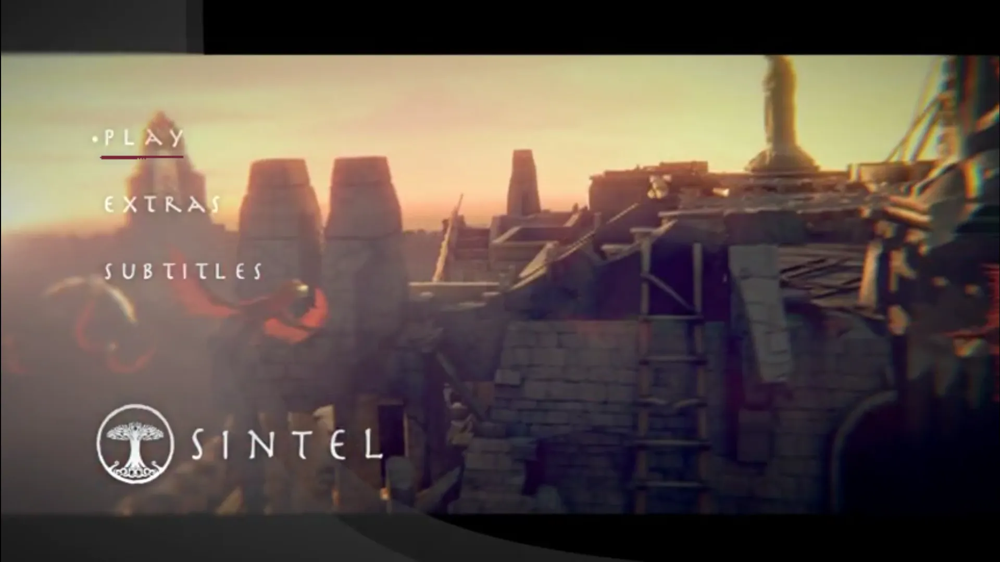
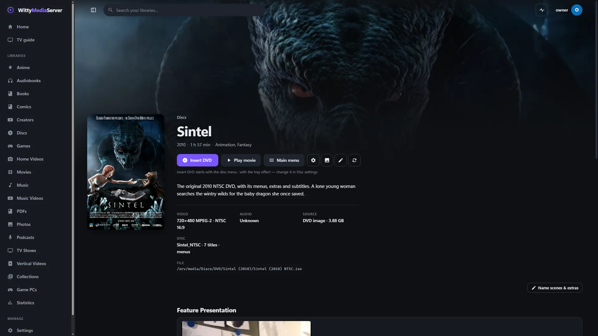
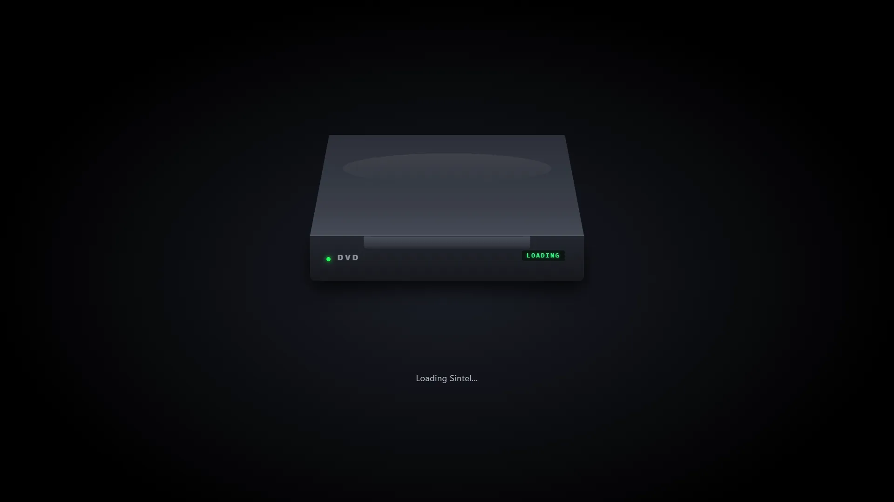
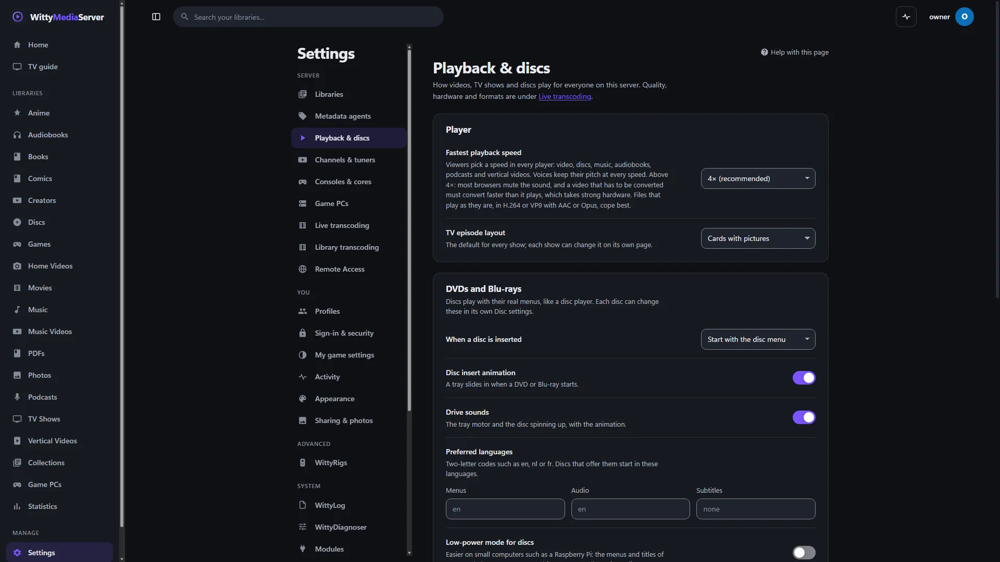

# WittyDVD

Plays DVD images and `VIDEO_TS` folders in WittyMediaServer the way a DVD player does, with their real menus. You need it if your disc libraries hold DVDs.

<!-- pictures -->



<sub>The disc's own menu, in a browser. [Sintel](https://durian.blender.org/), Blender Foundation, [CC BY 3.0](https://creativecommons.org/licenses/by/3.0/), from its original DVD.</sub>



<sub>A disc's page in WittyMediaServer. [Sintel](https://durian.blender.org/), Blender Foundation, [CC BY 3.0](https://creativecommons.org/licenses/by/3.0/).</sub>



<sub>A disc going in. [Sintel](https://durian.blender.org/), Blender Foundation, [CC BY 3.0](https://creativecommons.org/licenses/by/3.0/).</sub>



<sub>Settings, Playback & discs, in WittyMediaServer.</sub>

<!-- /pictures -->

## What it does

- **Plays the disc's own program:** first play, menus with highlighted buttons, titles, chapters, angles, audio and subtitle choices, stills, resume points and parental blocks. It runs the disc's commands in a small virtual machine.
- **Reads without mounting:** `.iso` and `.img` images and `VIDEO_TS` folders, through WittyDisc.
- **Draws subtitles and button highlights** from the disc's own sub-pictures and palette.
- **Copes with damage:** a broken IFO table is read from its `.BUP` backup, and malformed tables, commands and sub-pictures are refused rather than trusted.
- **Refuses scrambled discs.** CSS-protected images are detected and refused with a clear message. Nothing is ever decrypted. The server makes its own check as well, whatever a module says.
- **Tells you what's on a disc.** The `wittydvd` command-line tool lists titles and menus, simulates a run through the menus, and reports dead ends.
- **Finds the film among decoys.** A scoring engine ranks every title from the unencrypted index alone and gives its reasons. It looks at distinct video, cells replayed or shuffled, cells outside the video files, zero-length cell spam, looping chains, where first play and the menu's Play button go, stream counts and chapters. It also picks out a TV disc's episodes and its play-all title. It doesn't bypass CSS. See [docs/TITLE-HEURISTICS.md](docs/TITLE-HEURISTICS.md).

Decoding the video and audio is left to the player: WittyDVD says which bytes to play, when, and what to draw over them. Turning those steps into streams stays with the server.

How to use it is in **Help** inside WittyMediaServer: see DVDs. How titles are ranked is in [docs/TITLE-HEURISTICS.md](docs/TITLE-HEURISTICS.md).

## How to get it

An admin adds it from the module store inside WittyMediaServer: **Settings → Modules**, then **Browse the store**, then **Add** beside WittyDVD. That needs WittyMediaServer 0.6.0-alpha or later, and it works with nothing older. The range this version fits is in `module.json`: 0.6.0-alpha through 0.6.x.

## What it needs

- FFmpeg, which comes with the server.
- [WittyDisc](https://github.com/wittywilla/WittyDisc), which reads the images, and [WittyModule](https://github.com/wittywilla/WittyModule), which is how a server talks to it. Both are built in.
- No media comes with it.

It's written in Go with no cgo, from the published disc structure.

## Platforms

A program is built for each system below, and the server uses the right one.

| System | Where it stands |
|---|---|
| Linux (x64, arm64, 32-bit ARM, x86) | Its tests pass on x64, and a DVD title has played in a browser from a test server with it installed. The other CPUs are only built |
| Windows (x64, arm64) | Built. This version hasn't been run on Windows since it became its own program |
| macOS (Intel, Apple silicon) | Built by the release tool. It has not been run on a real Mac |
| FreeBSD (amd64, arm64) | Cross-compiled only. It has not been run |

On macOS and FreeBSD the server has no sandbox for a module's helper: it gets a small environment and a soft memory limit, and nothing more.

## Building and testing

You need Go 1.26 or newer. In a worktree, first run the copy of `dev-modules.mjs` kept above the repositories (`node D:/projects/dev-modules.mjs` on the development machine). It writes a `go.work` that git ignores, so the checkout builds against the repositories beside it. Never run `go work use`.

```bash
go vet ./...
```

```bash
go test ./... -count=1
```

```bash
go run github.com/wittywilla/wittymodule/cmd/wittymodule check .
```

The last one checks the manifest. On the same tool, `pack -targets linux/amd64 -out release .` builds a release for one system. CI also builds for every system.

To look at a disc by hand:

```bash
go run ./cmd/wittydvd info MY_DISC.ISO
```

| Command | What it shows |
|---|---|
| `wittydvd info <disc>` | Titles, menus, languages and the first-play program |
| `wittydvd walk <disc> [button...]` | Simulates inserting the disc, then pressing menu buttons by number |
| `wittydvd crawl <disc>` | Presses every button of every menu and reports dead ends |
| `wittydvd pgc <disc> <fp, vmgm, vtsm or vts> <vts> <pgcn>` | The commands of one program chain |
| `wittydvd render <disc> <dir>` | The first menu's highlight pictures |
| `wittydvd disc ls <disc>` | The files inside the image |

To use it as a library, `wittydvd.Open` opens an image or folder, and `wittydvd.NewNav` gives a navigator: `Start`, `PressButton`, `CellEnded` and the rest return what to do next. `Disc.MainTitle`, `Disc.RankTitles`, `Disc.Episodes` and `Disc.Explain` say which title is which, and `Opened.Analyze` adds the menu's own Play button.

`wittydvdplayer/` is the same engine as a program of its own for WittyMediaPlayer, with its own `go.mod` and manifest.

## Licence

GNU Affero General Public License v3.0 (or later): see [LICENSE](LICENSE) and [NOTICE](NOTICE). If you redistribute it or build on it, please keep the NOTICE attribution. It's an original implementation and contains no code from other disc libraries. Each release archive carries a `THIRD-PARTY-NOTICES.txt` for what its programs link.

## Legal

WittyDVD is an independent open-source project. It isn't associated with, sponsored by or endorsed
by the DVD format's owners, any film studio or any other player project. “DVD” is a trademark of DVD
Format/Logo Licensing Corporation; WittyDVD isn't a licensed or certified DVD product and uses no
DVD logo. CSS-scrambled discs are refused, nothing is decrypted, and no media comes with it: you're
responsible for having the rights to what you open. Any third-party names here only describe what it
works with, and belong to their owners. It's provided “as is”, with no warranty; see
[LICENSE](LICENSE). Local law applies to how you use it. This isn't legal advice.

<!-- module-kit -->
## Releasing

A version tag builds a program for every platform, signs the checksum list, and publishes a release that servers can install.

Versions move in small steps as work lands. `go run github.com/wittywilla/wittymodule/cmd/wittymodule@v0.3.0 bump .` raises it
everywhere it is written (add `-part minor` for a bigger step). A bump isn't a release: nothing is
tagged or published until you tag it. CI fails when code changed since the last tag and the version
didn't, because tags never move.

To release:

1. Check that `version` in `module.json` is the one to publish, with the bump committed.
2. Tag that commit and push the tag: `git tag vX.Y.Z`, then `git push origin vX.Y.Z`. A tag with a
   suffix, such as `v1.2.0-beta`, is published as a prerelease.
3. Watch the *Actions* tab. The signing step uses the `WMS_SIGNING_KEY` secret of the `release` environment, and nothing is published without it.

To take a version back, run the *withdraw* workflow from the *Actions* tab. It adds the version to a signed list on the release tagged `withdrawals`, which servers read.

Licensed under AGPL-3.0-or-later: see [LICENSE](LICENSE) and [NOTICE](NOTICE).
<!-- /module-kit -->
